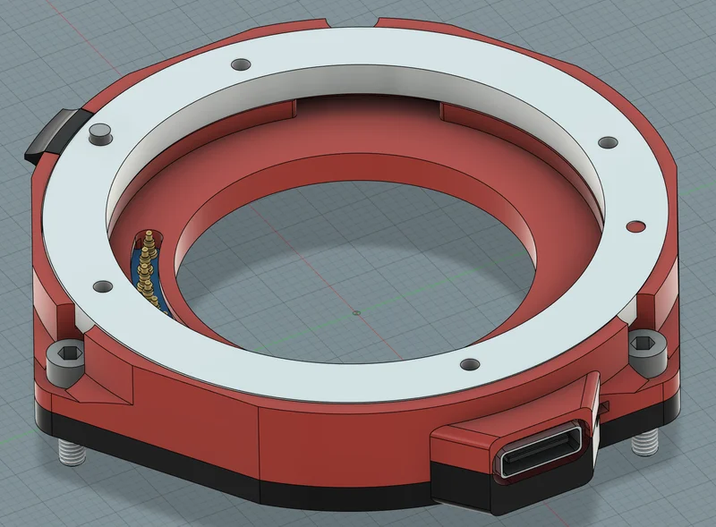

## Les pièces sur l'établi

| Pièce | Source |
|---|---|
| Carte Basilisk v1.0 et composants | [Dossier de fabrication](../../1_Board/README.md) |
| Boîtier, parties haute et basse | [3MF du boîtier](../../3_3D-Models/Basilisk_v1.0_enclosure.3mf) |
| Entourage USB | [3MF USB](../../3_3D-Models/Basilisk_v1.0_USB.3mf) |
| Fût métallique mâle, vis et loquet | Un demi-kit de bagues Meike MK-S-AF3A 10/16 mm |
| Fixation de la caméra | Trois vis M2.5×12 |
| Caméra | Un modèle indiqué dans [La bête](overview.fr.md) |

La [nomenclature mécanique](../../2_Hardware/Basilisk_v1.0_BoM.csv) est distincte de celle de la carte. L'[assemblage STEP](../../2_Hardware/Basilisk_v1.0_enclosure.step) contient les pièces du boîtier à adapter.

## Commander la carte

Utiliser les Gerber, BoM et fichiers de placement du dossier de fabrication. Les paramètres sont **2 couches, épaisseur 1,0 mm, cuivre 1 oz, masque noir, sérigraphie blanche, HASL RoHS**. L'assemblage se fait sur la face supérieure uniquement. P1–P10 sont dix pogo pins individuels ; CN2 n'est pas monté comme connecteur séparé.

L'assemblage JLCPCB est la voie documentée. À la main, il faut souder un microcontrôleur QFN, des passifs 0402 et de petits composants de puissance à pad exposé.

## Imprimer et ajuster

Pour les parties structurelles haute et basse, **le PC-CF est le matériau utilisé et validé sur les pièces du projet**. Le PETG est une alternative envisagée ; ABS et ASA n'ont pas été essayés. Ne pas utiliser de PLA pour ces pièces structurelles. L'entourage USB est en PETG transparent pour laisser voir la LED.

Vérifier l'ajustement du loquet avec votre matériau et votre imprimante : une reprise de quelques dixièmes de millimètre peut être nécessaire. Les trois vis M2.5×12 remplacent les M2.5×8 de la plaque avant de la caméra ; elles compensent la hauteur ajoutée et maintiennent des filets en prise.

## État de l'assemblage

L'assemblage final v1.0 avec les 3MF fournis n'a pas encore été vérifié et aucune séquence de montage pas à pas n'est validée. Les fichiers et indications de matériaux sont disponibles ; il manque encore ce dernier contrôle d'ajustement et ses photographies pour constituer un guide de reproduction complet. Aucun couple, épaisseur de cale ou ordre de serrage n'est inventé pour combler ce manque.

L'illustration montre la **v1.0b**, révision précédente ; utiliser les fichiers v1.0 liés ci-dessus.

Après vérification du montage, passer à l'[Installation](setup.fr.md).
