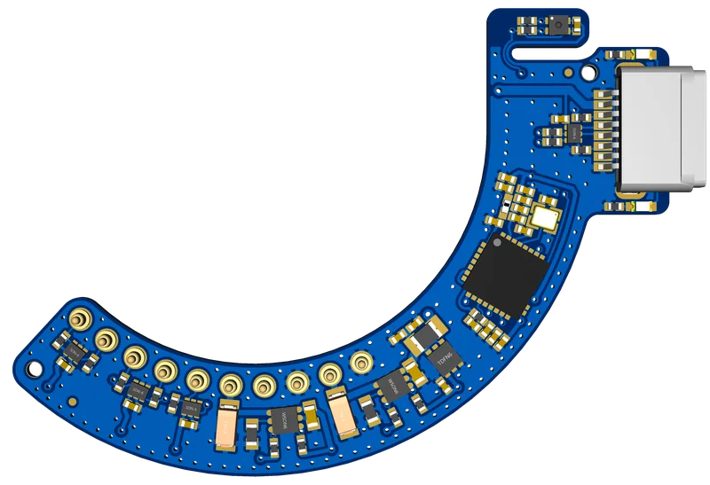
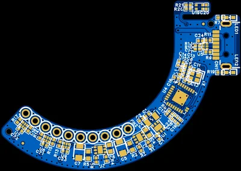
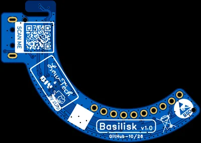

<!-- zurp-readme-header:begin — paste this block once, never again: the poster and the badges update themselves at each build of the site — do not edit it -->

<!-- zurp-readme-header:end -->

<h1 align="center">Basilisk</h1>

<strong><em>Bend the glass to your will</em></strong>

  <a href="https://zurp-astronomics.github.io/basilisk/">Website</a> ·
  <a href="7_Docs/">Documentation</a> ·
  <a href="../../releases">Releases</a> ·
  <a href="https://github.com/zUrp-Astronomics">zUrp Astronomics</a>

---

## 🚧 Work in progress — do not build yet 🚧

**Nothing here is validated on real hardware.** 
Files change without notice, and what you build today may need rework tomorrow. 
👀 Watch the repository to know when the first release lands.

---

## Why Basilisk?

Astro cameras don't speak Sony. **Basilisk does.** Put a Sony E lens on your astro camera and drive
its focus and aperture from Ekos/INDI or ASCOM — no camera body, one USB-C cable for power and data,
and you never leave the warm room. It speaks the Pinefeat serial protocol, so the Pinefeat INDI and
ASCOM drivers work with it unchanged. First target lens: the **Samyang AF 135 mm F1.8 FE**.

## At a glance

| | |
|---|---|
| Board | ring-shaped, 50.87 × 36.3 mm, parts on one side only |
| Link | one USB-C cable for power and data — no other supply, no camera body |
| Brain | ESP32-C3, native USB |
| Lens power | two switched, current-limited rails (5 V motor, 3.3 V logic), each reporting its faults |
| Lens interface | 10-contact Sony E-mount on single pogo pins, with lens detection |
| Protection | ESD on every lens line and on USB |
| Control | Ekos/INDI, ASCOM — Pinefeat-compatible |

## Hardware

 

The v1.0 board goes to its first production run; it is not validated yet — don't order it until it
is. Its manufacturing files are in `1_Board/`, the printable case in `3_3D-Models/`, its CAD sources
(STEP) in `2_Hardware/`.

## Software

- **Firmware** — `4_Firmware/`: ESP-IDF, no other dependency. Built for the ESP32-C3 of the v1.0 board
  (not yet validated on it).
- **Bench page** — `5_App/`: a single HTML page that drives the board from Chrome or Edge over Web
  Serial. Nothing to install.
- **tool_station** — `5_App/tool_station/`: reads and sets the M1/M2 custom switch of the Samyang
  AF 135, without Samyang's tool.
- **INDI driver** — `6_Driver/indi/`: `indi_basilisk_focus`, a focuser for Ekos. The stock Pinefeat
  drivers work too.

## Flash

1. **Download** the [latest release](https://github.com/zUrp-Astronomics/Basilisk/releases/latest).
2. **Plug** the board into the computer over USB-C, with a data cable. Nothing else: the flashing tool puts the
   board into download mode over USB.
3. **Flash**, one of three ways:
   - **In the browser, nothing to install — keeps your focus mark.** Firefox 151 or later, Chrome or Edge, on a
     computer (not Safari, not mobile). Unzip `basilisk_<tag>_esp32c3_flash.zip`, open Espressif's
     [esptool-js](https://espressif.github.io/esptool-js/), click **Connect** and pick the board's port, then add
     the three `.bin` files at the addresses listed in `flash_args`: `0x0` the `…-bootloader.bin`, `0x8000` the
     `…-partition-table.bin`, `0x10000` the application `….bin`. Click **Program**. Do not click **Erase Flash**.
   - **Command line — keeps your focus mark.** Install esptool (`pip install esptool`), unzip
     `basilisk_<tag>_esp32c3_flash.zip`, then run `sh flash.sh [PORT]` (Linux, macOS) or `flash.cmd [PORT]`
     (Windows) from that folder.
   - **Clean install — erases your focus mark.** Write `basilisk_<tag>_esp32c3.bin` at `0x0` (esptool-js or
     esptool), for a new chip or one that ran other firmware.

The port is `/dev/ttyACM0` on Linux, `/dev/cu.usbmodem…` on macOS and `COMx` on Windows ("USB Serial Device"); no
driver is needed.

## Build

**The easy way — JLCPCB assembly.** Send the Gerber, BoM and pick-and-place from `1_Board/` and order
the board assembled, top side only. The ten lens contacts are single pogo pins (P1–P10), listed with
the other top-side parts; the E-mount footprint CN2 is not wired. PCB options are in
`1_Board/Basilisk-v1.0_0-README.txt`: 2 layers, 1.0 mm, 1 oz copper, black solder mask, white
silkscreen, HASL RoHS.

**The hard way — do it all yourself.** Everything is in `1_Board/`. Expect fine-pitch work: a QFN
microcontroller, 0402 passives and tiny exposed-pad power parts.

## Documentation

- [`7_Docs/MANUEL.md`](7_Docs/MANUEL.md) — the user manual (French).
- [`7_Docs/PROTOCOL.md`](7_Docs/PROTOCOL.md) — the board's serial protocol (French).
- [`7_Docs/E-Mount/`](7_Docs/E-Mount/README.md) — Sony E-mount interoperability, seen from the camera
  body: how a body talks to its lens (English).

## Status & roadmap

- **v0.9** — the firmware of the v1.0 board, under test until the board is validated.
- **v1.0** — the ESP32-C3 board, once it is validated on the bench.

## Credits

Based on [Pinefeat](https://github.com/pinefeat/cef135): Basilisk speaks its serial protocol.

## Repository layout

| Folder | Contents |
|---|---|
| [`0_Datasheets/`](0_Datasheets/) | datasheets of the components, as published by their makers |
| [`1_Board/`](1_Board/) | board manufacturing files: schematics, views, Gerber, BoM, pick-and-place |
| [`2_Hardware/`](2_Hardware/) | mechanics outside the board: enclosure, parts, design sources, mechanical BoM |
| [`3_3D-Models/`](3_3D-Models/) | ready-to-print files |
| [`4_Firmware/`](4_Firmware/) | firmware: sources, build, tests |
| [`5_App/`](5_App/) | applications that talk to the product |
| [`6_Driver/`](6_Driver/) | drivers (INDI, ASCOM…) |
| [`7_Docs/`](7_Docs/) | documentation: manual, serial protocol, Sony E-mount interoperability |
| [`8_References/`](8_References/) | external reference documents: what the project reads, not what it produces |
| [`9_Assets/`](9_Assets/) | the showcase: product sheet, poster and README images |

## License

- **Hardware design** — boards, mechanics and 3D models: [Open Community License v1.1](LICENSE-HARDWARE).
- **Everything else** — firmware, software, documentation and images: [GNU GPL v3.0](LICENSE).

Third-party material keeps its own licence:

- `6_Driver/indi/` is under LGPL 2.1 (`6_Driver/indi/LICENSE`);
- the lens-name tables generated from ExifTool (`4_Firmware/components/host/lens_names.c`, the `LENS_NAMES` table of `5_App/emount-bench.html`) keep their source's licence;
- the datasheets in `0_Datasheets/` and the documents in `8_References/` belong to their authors.

---

<a href="https://zurp-astronomics.github.io/">zUrp Astronomics</a> — a subsidiary of zUrp Industries. Because buying is cheating.

